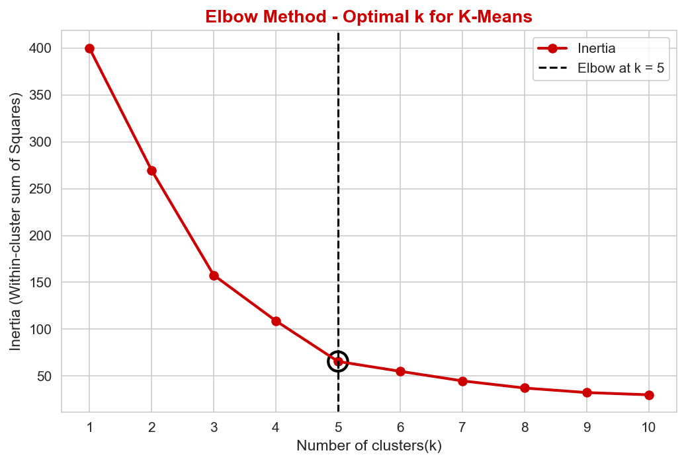
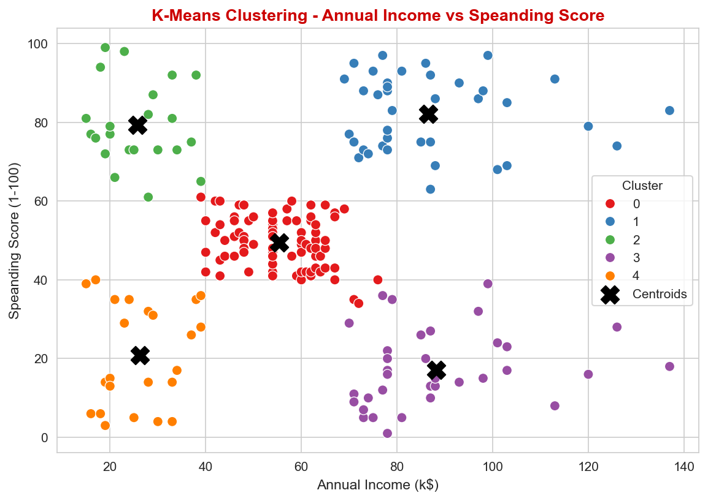
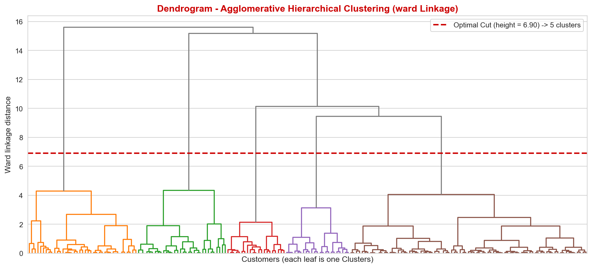
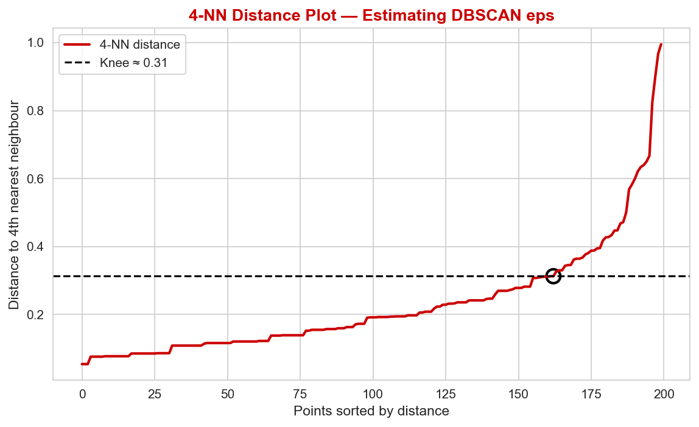
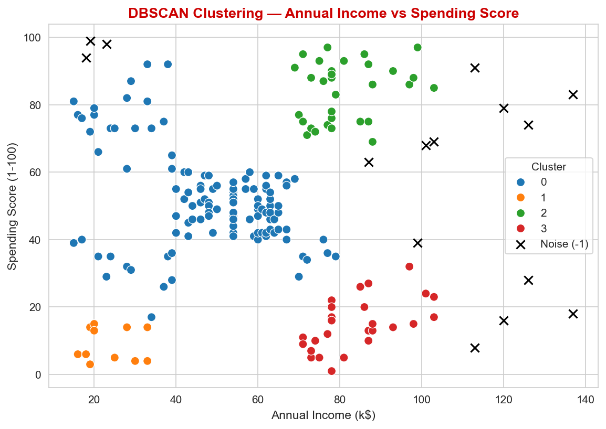
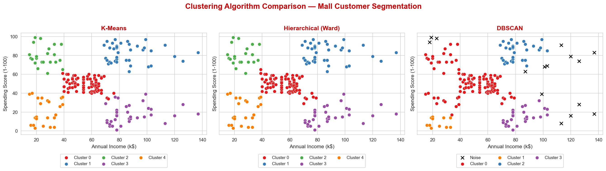

<p align="center">
  
</p>

<p align="center">
  <a href="PASTE_YOUR_VIDEO_LINK_HERE"><b>🎬 &nbsp;WATCH VIDEO EXPLANATION</b></a>
  &nbsp;&nbsp;·&nbsp;&nbsp;
  <a href="UL_PR1.html"><b>📄 &nbsp;OPEN HTML REPORT</b></a>
  &nbsp;&nbsp;·&nbsp;&nbsp;
  <a href="UL_PR1.ipynb"><b>📓 &nbsp;OPEN NOTEBOOK</b></a>
</p>

<p align="center">
  
  
  
  
  
</p>

---

## 🏬 MALL DIRECTORY

```text
╔════════════════════════════════════════════════════════════════════════╗
║  TITLE        : MALL CUSTOMER SEGMENTATION                             ║
║  REPORT       : Practical Report 1 · Unsupervised Learning             ║
╠════════════════════════════════════════════════════════════════════════╣
║  COURSE       : Unsupervised Learning, Red & White Skill Education     ║
║  AUTHOR       : Mayur Makwana                                          ║
║  GRID         : YOUR GRID                                              ║
║  CUSTOMERS    : 200 (no missing values)                                ║
║  CLUSTERED ON : Annual Income + Spending Score                         ║
║  ALGORITHMS   : K-Means · Hierarchical (Ward) · DBSCAN                 ║
║  RESULT       : 5 customer segments                                    ║
╚════════════════════════════════════════════════════════════════════════╝
```

In this project I segment **200 mall customers** into groups based on their annual income and spending score, using three clustering algorithms, and compare how each one behaves on the same data.

---

## 🗃️ DATASET

**[Mall Customer Segmentation Data on Kaggle](https://www.kaggle.com/datasets/vjchoudhary7/customer-segmentation-tutorial-in-python)** · License: CC0 · 200 customers · No missing values

| Column | Description |
|---|---|
| `CustomerID` | Unique customer ID |
| `Gender` | Customer gender |
| `Age` | Customer age |
| `Annual Income (k$)` | Annual income in thousand dollars |
| `Spending Score (1-100)` | Spending score assigned by the mall |

---

## 🗺️ WHAT I DID

```text
  ①  EDA
      Histograms with KDE · pairplot · correlation heatmap
      Correlations are weak (Income vs Spending ≈ 0.01), but the
      pairplot shows five clear blobs, so correlation alone hides
      the real structure.
            ↓
  ②  SCALING
      StandardScaler on Age, Income and Spending Score.
      Clustering uses the scaled Income and Spending Score.
            ↓
  ③  K-MEANS
      k picked with the Elbow method and Silhouette score.
      Both gave k = 5.
            ↓
  ④  HIERARCHICAL (WARD)
      Dendrogram cut at the longest vertical gap → 5 clusters.
            ↓
  ⑤  DBSCAN
      eps estimated from a 4-NN distance plot, then a grid
      search over eps and min_samples.
            ↓
  ⑥  COMPARISON
      Three-panel figure + Silhouette, Davies-Bouldin and
      Calinski-Harabasz scores for all three algorithms.
            ↓
  ⑦  EXTENSION
      K-Means repeated with all four features to check whether
      Age and Gender help.
```

---

## 🏆 RESULTS

| Algorithm | Clusters | Silhouette ↑ | Davies-Bouldin ↓ | Calinski-Harabasz ↑ |
|---|:-:|:-:|:-:|:-:|
| 🥇 **K-Means (k=5)** | 5 | **0.555** | **0.572** | **248.7** |
| 🥈 **Agglomerative, Ward** | 5 | 0.554 | 0.578 | 244.4 |
| 🥉 **DBSCAN** (eps=0.4, min_samples=5) | 4 + 15 noise points | 0.478 | 0.591 | 146.9 |

> [!NOTE]
> DBSCAN scores are computed **without the noise points**, so they are not strictly comparable with the other two.

---

## 💡 WHAT I FOUND

> [!IMPORTANT]
> **K-Means and Hierarchical give almost the same segments.** They differ on only **4 of 200** customers, all on the borders between touching clusters (Adjusted Rand Index **0.94**).

- 🔹 **DBSCAN finds 4 clusters instead of 5.** The low-income groups are connected to the dense central group, so it merges them. K-Means separates them because it assigns points to the nearest centre rather than following density.
- 🔹 **Most stable segments across all three algorithms:** High Income / High Spenders and High Income / Low Spenders.
- 🔹 **eps = 0.2 is misleading.** DBSCAN reaches a silhouette of about 0.6, but 73 to 95 customers become noise, so I chose **eps = 0.4** instead.
- 🔹 **Age and Gender don't help.** With all 4 features the best silhouette dropped from about 0.55 to 0.36, so Income and Spending Score stay the main segmentation basis.

---

## 🛒 CUSTOMER SEGMENTS (K-Means)

| Segment | Customers | Avg age | Avg income (k$) | Avg spending score |
|---|:-:|:-:|:-:|:-:|
| 🟡 **Mid Income, Mid Spenders** | 81 | 42.7 | 55.3 | 49.5 |
| 🟢 **High Income, High Spenders** | 39 | 32.7 | 86.5 | 82.1 |
| 🟣 **High Income, Low Spenders** | 35 | 41.1 | 88.2 | 17.1 |
| 🔵 **Low Income, Low Spenders** | 23 | 45.2 | 26.3 | 20.9 |
| 🔴 **Low Income, High Spenders** | 22 | 25.3 | 25.7 | 79.4 |

The notebook has a **marketing recommendation for each segment** and explains why I recommend **K-Means for deployment**.

---

## 🖼️ PLOTS

<table>
<tr>
<td width="50%" align="center">
  <br>
  <sub><b>Elbow method</b> · inertia vs k</sub>
</td>
<td width="50%" align="center">
  <br>
  <sub><b>Silhouette score</b> vs k</sub>
</td>
</tr>
<tr>
<td width="50%" align="center">
  <br>
  <sub><b>K-Means clusters</b> · centroids marked with black X</sub>
</td>
<td width="50%" align="center">
  <br>
  <sub><b>Ward dendrogram</b> with the cut line</sub>
</td>
</tr>
<tr>
<td width="50%" align="center">
  <br>
  <sub><b>4-NN distance plot</b> used to estimate eps</sub>
</td>
<td width="50%" align="center">
  <br>
  <sub><b>DBSCAN clusters</b> · noise shown as black x</sub>
</td>
</tr>
<tr>
<td colspan="2" align="center">
  <br>
  <sub><b>K-Means vs Hierarchical vs DBSCAN</b></sub>
</td>
</tr>
</table>

---

## 🗂️ REPOSITORY CONTENTS

```text
🛍️ mall-customer-segmentation/
 ├─ 📓 UL_PR1.ipynb          main notebook (all 7 tasks)
 ├─ 📄 UL_PR1.html           HTML export of the notebook
 ├─ 📊 Mall_Customers.csv    dataset
 ├─ 📄 requirements.txt      Python dependencies
 ├─ 📁 screenshots/          saved plots
 └─ 📁 assets/               README header
     └─ 🎞️ mall_header.svg
```

---

## 🧰 TOOLS

`Python` · `pandas` · `NumPy` · `scikit-learn` · `SciPy` · `Matplotlib` · `Seaborn` · `Jupyter Notebook`

---

## ▶️ RUN IT YOURSELF

```bash
pip install -r requirements.txt
jupyter notebook UL_PR1.ipynb
```

Then use **Kernel → Restart & Run All**. The notebook reads `Mall_Customers.csv` from the same folder and saves plots to `screenshots/`.

---

<p align="center">
  <b>✍️ Mayur Makwana</b> · GRID: YOUR GRID<br>
  <sub>Practical Report 1 · Unsupervised Learning · Red & White Skill Education</sub>
</p>
